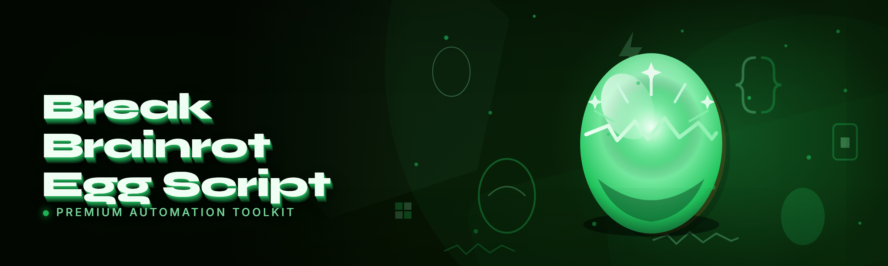

  
  
  

  

  
  

---

**Break a Brainrot Egg Script** is a 2026 auto-farm script for the *Break a Brainrot* egg-hatching experience — it automates the hatch/break loop, sorts trash pets from carry-grade ones, and keeps your inventory spinning while you're AFK.

I got tired of babysitting the same egg-break animation for the fourth hour straight, so I wrote a script that does the boring part and hands me the good part.

---

## 📚 Table of Contents

- [Compatibility / Platform Support](#-compatibility--platform-support)
- [Roadmap / Planned Features](#-roadmap--planned-features)
- [The Solution](#-the-solution)
- [Grouped Module Catalog](#-grouped-module-catalog)
  - [🍳 Egg Breaking Core](#-egg-breaking-core)
  - [🐾 Pet Sorting & Inventory](#-pet-sorting--inventory)
  - [🎯 Auto-Farm & AFK](#-auto-farm--afk)
  - [🖥️ Overlay & HUD](#️-overlay--hud)
  - [🛠️ Utility & Safety](#️-utility--safety)
- [The Problem](#-the-problem)
- [Quick Start](#-quick-start)
- [Key Features](#-key-features)
- [Hotkeys / Keybind Table](#-hotkeys--keybind-table)
- [How It Works](#-how-it-works)
- [Known Issues](#-known-issues)
- [Installation](#-installation)
- [How To Use](#-how-to-use)
- [FAQ](#-faq)
- [Changelog](#-changelog)

---

## 🖥️ Compatibility / Platform Support

| Component | Supported | Notes |
|-----------|-----------|-------|
| Windows 10 (21H2+) | ✅ Full | Tested on clean install |
| Windows 11 (23H2+) | ✅ Full | Primary dev target for 2026 build |
| Windows 8.1 | ⚠️ Partial | Overlay may flicker — use windowed mode |
| macOS | ❌ No | No current plans |
| Linux / Wine | ⚠️ Experimental | Works under Proton, overlay broken |
| Executor (generic injector) | ✅ Full | Any Lua-capable executor |
| Roblox client | ✅ Current | Updated for latest 2026 client build |
| 4GB RAM | ✅ Minimum | 8GB recommended for overlay + farm |

---

## 🗺️ Roadmap / Planned Features

| Feature | Status | ETA |
|---------|--------|-----|
| Multi-egg queue | ✅ Shipped | — |
| Rarity filter for auto-keep | ✅ Shipped | — |
| Auto-sell trash pets | ✅ Shipped | — |
| Overlay HUD with live stats | ✅ Shipped | — |
| Webhook notifications on rare hatch | 🔄 In Progress | Q2 2026 |
| Discord rich presence | 🔄 In Progress | Q2 2026 |
| Multi-account farm rotation | 📋 Planned | Q3 2026 |
| Mobile executor support | 📋 Planned | Q4 2026 |
| Auto-trade rare pets to alt | 💭 Idea | Unscheduled |

---

## 🎯 The Solution

Here's the honest breakdown — problem on the left, what the script actually does about it on the right.

| Problem | Solution |
|---------|----------|
| Egg-break animation is slow and repetitive | Auto-break loop with configurable delay |
| You can't tell a trash pet from a carry pet at a glance | Rarity + stat sort with keep/sell rules |
| Inventory fills up with junk while AFK | Auto-sell below threshold |
| You fall asleep and miss the rare hatch | Webhook ping + overlay flash |
| Executor script tabs break on game updates | Modular loader with version check |
| You can't tell if the script is even running | Live overlay HUD with tick counter |

---

## 🧩 Grouped Module Catalog

Every module listed below is something I've actually run in-game. If it's listed as working, it's working on the current build — I don't mark things ✅ because they *should* work.

### 🍳 Egg Breaking Core

The core loop is the whole reason this exists. It queues eggs, fires the break action, waits for the animation frame to clear, then immediately re-queues. The delay is tunable because the game's server-side cooldown isn't perfectly consistent — you'll want to nudge it up if you get soft-locked.

- **Auto-Break Loop** — Continuous egg-break with configurable inter-break delay
- **Multi-Egg Queue** — Chains N eggs back to back without manual re-click
- **Smart Cooldown Detection** — Pauses when the game reports a cooldown, resumes on clear
- **Break Speed Throttle** — Caps breaks-per-minute so you don't look robotic
- **Fail-Safe Stop** — Halts the loop if the break action fails twice in a row

### 🐾 Pet Sorting & Inventory

This is the category I rebuilt three times. Early versions sorted by name and it was useless — pet names in this game are non-unique and misleading. Now it sorts by rarity tier + a stat score you can weight yourself.

- **Rarity Filter** — Keep/discard by rarity tier (Common → Mythic)
- **Stat Score Threshold** — Weighted score; below threshold = auto-sell
- **Auto-Sell Trash** — Sells below-threshold pets on a timer
- **Lock Favorites** — Whitelist specific pets so the sorter never touches them
- **Inventory Cap Guard** — Stops breaking when inventory hits a set percentage
- **Duplicate Detector** — Flags pets you already own above a quality bar

### 🎯 Auto-Farm & AFK

The AFK farm is the module I get the most DMs about. It's not magic — it just keeps the break loop alive and reconnects if the client drops. It does *not* teleport or noclip; that's a different kind of script and outside what this does.

- **AFK Farm Mode** — Runs the break loop indefinitely with periodic anti-idle input
- **Anti-Idle Nudge** — Tiny input jitter so the game doesn't flag you AFK
- **Auto-Reconnect** — Reloads the script context after a disconnect
- **Session Logger** — Logs every break and every rare drop to a local file
- **Time-Boxed Sessions** — Auto-stops after N minutes if you set a limit
- **Schedule Mode** — Start/stop at set clock times (useful for overnight runs)

### 🖥️ Overlay & HUD

The overlay is a small always-on-top window drawn separately from the game. It reads module state and displays it — it does not hook the render pipeline, which is why it survives game updates that break other overlays.

- **Live Stats HUD** — Breaks/min, total breaks, session time
- **Rare Drop Flash** — Screen-edge flash when a rare+ pet drops
- **Module Toggle Panel** — Click to toggle modules without opening the script menu
- **Compact Mode** — Small HUD for low-resource runs
- **Log Viewer** — Scrollable session log inside the overlay

### 🛠️ Utility & Safety

These are the modules that keep the script from doing something embarrassing. The panic key alone has saved me from walking away mid-run more times than I can count.

- **Panic Key** — Instant full-stop hotkey
- **Version Check** — Warns if the game client version changed
- **Config Save/Load** — Persist your settings between sessions
- **Dry Run Mode** — Simulates the loop without actually breaking eggs
- **Safe Mode** — Disables auto-sell and auto-farm, keeps only manual modules

---

## 😤 The Problem

- The egg-break loop is a **five-second animation you have to watch hundreds of times**
- Rarity tiers look similar in the inventory grid — **you sell a carry pet by mistake**
- Auto-clickers break on the game's **variable server-side cooldown**
- AFK farming gets you **kicked for idle** within a few minutes
- Every game update **breaks half the scripts in the community**
- There's no way to know if a script is **actually running or silently dead**
- You wake up to find **your inventory full of commons** and a rare hatch missed

---

## 🚀 Quick Start

1. 🧾 **Visit the project page** and grab the current 2026 build
2. 📦 **Extract** the archive to any folder (no installer, no dependencies)
3. ▶️ **Run the .exe** — it opens the loader panel
4. 🎮 **Attach** to your executor and paste the generated script
5. 🥚 **Hit Start** — the break loop picks up from wherever you are

---

  

---

## ⭐ Key Features

| Feature | Description | Benefit |
|---------|-------------|---------|
| Auto-Break Loop | Continuous egg breaking with tunable delay | Farm without watching the animation |
| Rarity Filter | Keep/sell rules by tier | Never sell a carry pet again |
| Stat Scoring | Weighted score per pet | Objective keep/sell decision |
| Auto-Sell | Timer-driven trash purge | Inventory never fills |
| Overlay HUD | Live stats window | Know it's running at a glance |
| Panic Key | Instant stop | Bail out fast |
| Auto-Reconnect | Reloads after disconnect | Survives overnight runs |
| Session Log | Local file log | Audit what dropped |
| Config Save/Load | Persist settings | No re-tuning every session |
| Dry Run | Simulate without breaking | Test before committing |

---

## ⌨️ Hotkeys / Keybind Table

All hotkeys are rebindable in the overlay panel. Defaults below.

| Action | Default Key | Scope |
|--------|-------------|-------|
| Toggle break loop | `F1` | Global |
| Toggle overlay | `F2` | Global |
| Panic stop (all modules) | `F3` | Global |
| Open module panel | `F4` | Global |
| Toggle auto-sell | `F5` | Global |
| Toggle AFK mode | `F6` | Global |
| Reload config | `F7` | Global |
| Screenshot session log | `F8` | Global |

---

## ⚙️ How It Works

The build is a thin `.exe` loader that opens a small local panel and generates a Lua script string tailored to your config. The Lua side is modular — each module registers itself with a central scheduler that ticks on a fixed interval, so a hung module can't stall the whole loop. State is written to a local config file every few seconds so a crash doesn't wipe your settings. The overlay is a separate always-on-top window that polls the scheduler's state snapshot rather than hooking the render pipeline, which is why it survives game updates that break render-hooked overlays. The rarity filter and stat scoring run entirely locally against values you supply — the script doesn't ship with a hardcoded pet database, because that database would be stale within a week of any game update.

---

## 🐞 Known Issues

| Issue | Fix |
|-------|-----|
| Break loop stalls after ~2h | Restart the loop via F1 (toggle off/on) |
| Overlay flickers on Win 8.1 | Run game in windowed mode |
| Auto-sell fires on locked pets | Re-save favorites after config edit |
| Executor inject race on first run | Wait 3s after joining before pasting |
| Log file grows large on long runs | Enable log rotation in config |

---

## 📦 Installation

1. **Download** the current build from the project page via the 

  

 link.
2. **Extract** the archive to any folder — no installer, no dependencies, no runtime to install.
3. **Run the .exe** — it opens the loader panel. Windows SmartScreen may warn on first run; click "More info" → "Run anyway".

---

## 🎮 How To Use

1. Launch the game and join the server you want to farm on.
2. Attach your executor to the game client.
3. Open the loader panel (the .exe), set your rarity rules and delays.
4. Click **Generate Script**, copy the output, paste it into your executor.
5. Hit `F1` to start the break loop — the overlay HUD confirms ticks.

---

## ❓ FAQ

<b>Do I need to modify the game files?</b>

No. The script runs through an executor and never touches game files on disk.

<b>Will I get banned?</b>

Any automation in a live-service game carries risk. The break-speed throttle and anti-idle jitter reduce the obvious flags, but this is not a guarantee. Use your own judgment.

<b>Why is there no pet database built in?</b>

Because it goes stale fast. You supply rarity tiers and weights yourself in the config, and the script works off those. It's a little more setup, but it survives game updates.

<b>Does the overlay hook the render pipeline?</b>

No — it's a separate always-on-top window polling a state snapshot. That's intentional; render-hooked overlays break on almost every game update.

<b>Can I run multiple accounts at once?</b>

Not in the current build. Multi-account rotation is on the roadmap for Q3 2026.

**Q:** The break loop keeps stalling after a couple hours — what gives?

**A:** Toggle F1 off and back on. There's a known state-leak in the long-run scheduler that I haven't tracked down yet; restarting the loop clears it.

**Q:** Can I bind the panic key to something other than F3?

**A:** Yes — open the overlay panel, click the hotkey row, press your new key. It saves to config automatically.

**Q:** Does dry run still log?

**A:** Yes, dry run logs everything as if it were a real run, it just doesn't fire the break action. Good for testing your rarity rules before committing.

**Q:** Is there an auto-update?

**A:** No. Version check warns you if the game client changed, but you re-download manually from the project page. I've seen too many auto-updaters ship a broken build silently.

---

## 📝 Changelog

- **2026.1** — Added webhook-ready hooks, webhook module in progress
- **2025.4** — Rebuilt pet sorter (rarity + stat score, replacing name-based sort)
- **2025.3** — Overlay HUD rewritten to poll state snapshot instead of render hook
- **2025.2** — Added panic key and safe mode

---

That's the current build. It's not the fanciest script in the community and it isn't trying to be — it's the one I actually use on my own account, so if something's broken I hear about it fast. If you hit a bug the Known Issues table doesn't cover, open an issue with your session log attached and I'll look at it.

Use it responsibly — this is a hobby project, not a supported product, and the risk is yours.

  

